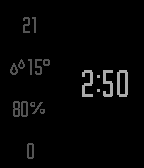

<!-- Generated by scripts/update_app_directory.py: do not edit by hand -->
[← All Pebble Developers](../developers.md)

# Remi Gelinas

*1 watchface · Last updated 2026-10-11 · [About these lists](../about-app-lists.md)*

Links: [Pebble App Store](https://apps.repebble.com/apps/dev/remi-gelinas_56fbf21ce673a954e800003b) · [GitHub (remi-gelinas)](https://github.com/remi-gelinas)

<h2 class="app-name" id="app-574008692b7d649524000004"><a href="https://apps.repebble.com/574008692b7d649524000004">Digitalin</a> v1.0</h2>
<a class="app-source" href="https://github.com/remi-gelinas/digitalin" title="Source code" data-search-exclude>View source</a>

Watchface

Released 2016-05-21 Updated 2016-05-21

Runs on: Time 2, Pebble 2 Duo, Pebble 2, Time, Classic

Digitalin is a heavily modified custom version of the stunningly elegant watchface Minimalin. Please report any issues through the Github repository issue tracker :D If you&#x27;re looking for a…

