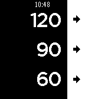

<!-- Generated by scripts/update_app_directory.py: do not edit by hand -->
[← All Pebble Developers](../developers.md)

# Remy Sharp

*1 app · Last updated 2026-10-12 · [About these lists](../about-app-lists.md)*

Links: [Pebble App Store](https://apps.repebble.com/apps/dev/remy-sharp_52f219def21676b008001172) · [GitHub (remy)](https://github.com/remy) · [Website (remy.github.io)](http://remy.github.io/rest/)

<h2 class="app-name" id="app-53ff41ed8cdf37902b000050"><a href="https://apps.repebble.com/53ff41ed8cdf37902b000050">Rest</a> v2.0</h2>
<a class="app-source" href="https://github.com/remy/rest" title="Source code" data-search-exclude>View source</a>

App

Released 2014-08-28 Updated 2015-07-29

Runs on: Time 2, Pebble 2 Duo, Pebble 2, Time, Classic

Simple and intuitive rest interval timer. Particularly useful for timing rests in the gym, with configurable presets, vibrate on done and an overrun counter. The main menu buttons also work on the…

