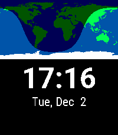
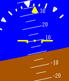

<!-- Generated by scripts/update_app_directory.py: do not edit by hand -->
[← All Pebble Developers](../developers.md)

# Ren Gianforte

*3 watchfaces and 1 app · Last updated 2026-10-11 · [About these lists](../about-app-lists.md)*

Links: [Pebble App Store](https://apps.repebble.com/apps/dev/ren-gianforte_53066f557f35761076000456) · [GitHub (rengianforte)](https://github.com/rengianforte)

<button type="button" data-filter="all" aria-pressed="true">All 4</button><button type="button" data-filter="watchface" aria-pressed="false">Watchfaces 3</button><button type="button" data-filter="watchapp" aria-pressed="false">Apps 1</button>

<label class="dev-sort">Sort by <select><option value="updated">Recently updated</option><option value="released">Newest release</option><option value="title">A–Z</option></select></label>

<h2 class="app-name" id="app-530bd23d3add7beccc0001e3"><a href="https://apps.repebble.com/530bd23d3add7beccc0001e3">Day and Night Earth Watchface</a> v1.7.0</h2>
<a class="app-source" href="https://github.com/rengianforte/pebble-day-night" title="Source code" data-search-exclude>View source</a>

Watchface · <a href="https://forum.rebble.io/t/1037" title="Discuss this app on the Rebble forum" data-search-exclude>Forum thread</a>

Released 2014-02-24 Updated 2026-06-10

Runs on: Time 2, Pebble 2 Duo, Pebble 2, Time, Classic

This watchface shows a world map with the current sunlight coverage, along with the time and date. Watch daylight pass across the earth as the day goes by, and see how the sun hits the earth at…

<h2 class="app-name" id="app-55955f6449b3c8ed50000051"><a href="https://apps.repebble.com/55955f6449b3c8ed50000051">Ponies</a> v1.3</h2>
<a class="app-source" href="https://github.com/rengianforte/pebble-ponies" title="Source code" data-search-exclude>View source</a>

Watchface

Released 2015-07-02 Updated 2016-07-04

Runs on: Time 2, Pebble 2 Duo, Pebble 2, Time, Classic

A random pony image out of 30 is displayed per minute; along with the time, date, and a battery meter.

<h2 class="app-name" id="app-576366902946d71c0b00000d"><a href="https://apps.repebble.com/576366902946d71c0b00000d">Victor&#x27;s Watch (Cosmos Laundromat)</a> v1.0</h2>
<a class="app-source" href="https://github.com/rengianforte/pebble-antonis" title="Source code" data-search-exclude>View source</a>

Watchface

Released 2016-06-17 Updated 2016-06-17

Runs on: Round 2, Time 2, Time Round, Time

This is a recreation of Victor&#x27;s Watch from &quot;Cosmos Laundromat: First Cycle&quot;. Go watch it if you haven&#x27;t seen it! This watch shows hours on the left, minutes on the right, and seconds in the…

<h2 class="app-name" id="app-55a45e4ce6f9096732000077"><a href="https://apps.repebble.com/55a45e4ce6f9096732000077">Attitude Indicator</a> v1.0</h2>
<a class="app-source" href="https://github.com/rengianforte/pebble-attitude-indicator" title="Source code" data-search-exclude>View source</a>

App

Released 2015-07-14 Updated 2015-07-14

Runs on: Time 2, Time

This app uses the Pebble&#x27;s accelerometer to simulate an attitude indicator. The main indicator shows an artificial horizon and degrees of pitch up or down. The bank indicator at the top displays…

