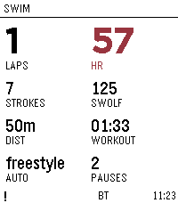
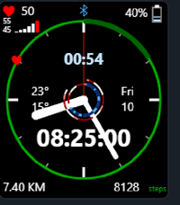

<!-- Generated by scripts/update_app_directory.py: do not edit by hand -->
[← All Pebble Developers](../developers.md)

# Rene Coffeng

*1 watchface and 1 app · Last updated 2026-10-11 · [About these lists](../about-app-lists.md)*

Links: [Rebble App Store](https://apps.rebble.io/en_US/developer/6a524100b297de00081b9f83/1) · [GitHub (coffeng)](https://github.com/coffeng) · [Website (drive.google.com)](https://drive.google.com/file/d/1FkI4EKjpz8UTo7es4a2vubu8w8218oVf/view?usp=drive_link)

<button type="button" data-filter="all" aria-pressed="true">All 2</button><button type="button" data-filter="watchface" aria-pressed="false">Watchfaces 1</button><button type="button" data-filter="watchapp" aria-pressed="false">Apps 1</button>

<label class="dev-sort">Sort by <select><option value="updated">Recently updated</option><option value="released">Newest release</option><option value="title">A–Z</option></select></label>

<h2 class="app-name" id="app-6a67197c81cc7800096d0f77"><a href="https://apps.rebble.io/en_US/application/6a67197c81cc7800096d0f77">Swim Tracker</a> v2.0.0</h2>
<a class="app-source" href="https://drive.google.com/file/d/1PVfQHVpM8_gSF2-BslJrJ9O1d9uKIF16/view?usp=drive_link" title="Source code" data-search-exclude>View source</a>

App · <a href="https://forum.rebble.io/t/1192" title="Discuss this app on the Rebble forum" data-search-exclude>Forum thread</a>

Released 2026-07-27 Updated 2026-08-22 Rebble App Store

Runs on: Round 2, Time 2, Pebble 2 Duo, Pebble 2, Time Round, Time

Swim Tracker - watch app with accelerometer-based stroke counting, template-matched turn detection, stroke classification, and cloud sync via Google Apps Script for report generation and…

<h2 class="app-name" id="app-6a5248c9c5fa780009da3efd"><a href="https://apps.rebble.io/en_US/application/6a5248c9c5fa780009da3efd">Analog Arcs</a> v1.0.1</h2>
<a class="app-source" href="https://github.com/coffeng/Pebble-Watchface-Analog-Arcs" title="Source code" data-search-exclude>View source</a>

Watchface · <a href="https://forum.rebble.io/t/1146" title="Discuss this app on the Rebble forum" data-search-exclude>Forum thread</a>

Released 2026-07-11 Updated 2026-07-27 Rebble App Store

Runs on: Time 2

Display activiy and sleep arcs on an analog watch. Includes also heart rate trend.

