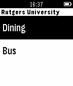

<!-- Generated by scripts/update_app_directory.py: do not edit by hand -->
[← All Pebble Developers](../developers.md)

# Revan Sopher

*1 app · Last updated 2026-10-12 · [About these lists](../about-app-lists.md)*

Links: [Pebble App Store](https://apps.repebble.com/apps/dev/revan-sopher_5439632ffe01ff7df0000218) · [GitHub (revan)](https://github.com/revan)

<h2 class="app-name" id="app-5521a22dd7356c80ea000059"><a href="https://apps.repebble.com/5521a22dd7356c80ea000059">Rutgers Bus and Dining</a> v1.0</h2>
<a class="app-source" href="https://github.com/revan/Pebble-Rutgers" title="Source code" data-search-exclude>View source</a>

App

Released 2015-04-05 Updated 2015-04-07

Runs on: Time 2, Pebble 2 Duo, Pebble 2, Time, Classic

Provides bus times and dining hall menus for Rutgers New Brunswick.

