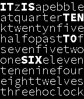
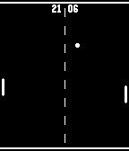

<!-- Generated by scripts/update_app_directory.py: do not edit by hand -->
[← All Pebble Developers](../developers.md)

# rexmac

*2 watchfaces · Last updated 2026-10-11 · [About these lists](../about-app-lists.md)*

Links: [Pebble App Store](https://apps.repebble.com/apps/dev/rexmac_52ce189483a666f6f9000017) · [GitHub (rexmac)](https://github.com/rexmac) · [Website (rexmac.com)](http://rexmac.com/chronocode)

<button type="button" data-filter="all" aria-pressed="true">All 2</button><button type="button" data-filter="watchface" aria-pressed="false">Watchfaces 2</button><button type="button" data-filter="watchapp" aria-pressed="false" disabled>Apps 0</button>

<label class="dev-sort">Sort by <select><option value="updated">Recently updated</option><option value="released">Newest release</option><option value="title">A–Z</option></select></label>

<h2 class="app-name" id="app-52ce238883a66692c700001e"><a href="https://apps.repebble.com/52ce238883a66692c700001e">ChronoCode</a> v2.2.5</h2>
<a class="app-source" href="https://github.com/rexmac/pebble-chronocode" title="Source code" data-search-exclude>View source</a>

Watchface

Released 2014-01-09 Updated 2014-04-24

Runs on: Time 2, Pebble 2 Duo, Pebble 2, Time, Classic

ChronoCode (f.k.a. WordSquare) displays the current time by emphasizing words &quot;hidden&quot; among a jumble of seemingly random letters. The time is displayed in sentence form, e.g. &quot;It is five…

<h2 class="app-name" id="app-52d428519260fe10be00002d"><a href="https://apps.repebble.com/52d428519260fe10be00002d">PingChrong</a> v2.0.0</h2>
<a class="app-source" href="https://github.com/rexmac/pebble-pingchrong" title="Source code" data-search-exclude>View source</a>

Watchface

Released 2014-01-13 Updated 2014-01-13

Runs on: Time 2, Pebble 2 Duo, Pebble 2, Time, Classic

Displays a game of ping-pong between two AI opponents. The score is shown at the top of the screen. Although they play 24/7, the AI players are quite good. So good in fact, that the player on the…

