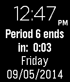

<!-- Generated by scripts/update_app_directory.py: do not edit by hand -->
[← All Pebble Developers](../developers.md)

# RHuffy

*1 watchface · Last updated 2026-10-12 · [About these lists](../about-app-lists.md)*

Links: [Pebble App Store](https://apps.repebble.com/apps/dev/rhuffy_52cb1fe8e2dd020cb1000044) · [GitHub (rhuffy)](https://github.com/rhuffy) · [Website (forum.xda-developers.com)](http://forum.xda-developers.com/pebble/pebble-development/competition-school-schedule-how-time-t2852455)

<h2 class="app-name" id="app-540a3b12c7980ced84000021"><a href="https://apps.repebble.com/540a3b12c7980ced84000021">School Schedule</a> v1.0</h2>
<a class="app-source" href="https://github.com/rhuffy/School-Schedule/" title="Source code" data-search-exclude>View source</a>

Watchface

Released 2014-09-05 Updated 2014-09-05

Runs on: Time 2, Pebble 2 Duo, Pebble 2, Time, Classic

This watchface allows you to enter in your daily schedule, and it displays how much time is remaining in the current time block. A quick glance at your Pebble will tell you exactly how much time…

