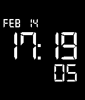

<!-- Generated by scripts/update_app_directory.py: do not edit by hand -->
[← All Pebble Developers](../developers.md)

# Ricardo González

*1 watchface · Last updated 2026-10-12 · [About these lists](../about-app-lists.md)*

Links: [Pebble App Store](https://apps.repebble.com/apps/dev/ricardo-gonz-lez_52cbd3a96e5f7017d000011e) · [GitHub (ryck)](https://github.com/ryck) · [Website (ryck.github.io)](http://ryck.github.io/BN0046/)

<h2 class="app-name" id="app-52f8d85135591d62950001db"><a href="https://apps.repebble.com/52f8d85135591d62950001db">BN0046</a> v2.1.1</h2>
<a class="app-source" href="https://github.com/ryck/BN0046" title="Source code" data-search-exclude>View source</a>

Watchface

Released 2014-02-10 Updated 2014-02-17

Runs on: Time 2, Pebble 2 Duo, Pebble 2, Time, Classic

The classy and elegant Braun BN0046 watch converted to a Pebble watchface.

