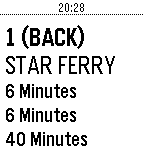

<!-- Generated by scripts/update_app_directory.py: do not edit by hand -->
[← All Pebble Developers](../developers.md)

# Richard Fan

*1 app · Last updated 2026-10-12 · [About these lists](../about-app-lists.md)*

Links: [Pebble App Store](https://apps.repebble.com/apps/dev/richard-fan_551014fb46cb798a100000d1) · [GitHub (richardfan1126)](https://github.com/richardfan1126)

<h2 class="app-name" id="app-576e766d6c21042b7b00004f"><a href="https://apps.repebble.com/576e766d6c21042b7b00004f">KMB Estimate Arrival Time</a> v1.3</h2>
<a class="app-source" href="https://github.com/richardfan1126/pebble-kmb-eta" title="Source code" data-search-exclude>View source</a>

App

Released 2016-06-25 Updated 2016-06-26

Runs on: Round 2, Time 2, Pebble 2 Duo, Pebble 2, Time Round, Time, Classic

Pebble app for getting KMB bus arrival time

