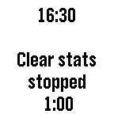

<!-- Generated by scripts/update_app_directory.py: do not edit by hand -->
[← All Pebble Developers](../developers.md)

# Richard Johnson

*3 apps · Last updated 2026-10-12 · [About these lists](../about-app-lists.md)*

Links: [Pebble App Store](https://apps.repebble.com/apps/dev/richard-johnson_52f0112a949454fbcc00012f) · [GitHub (rajid)](https://github.com/rajid)

<button type="button" data-filter="all" aria-pressed="true">All 3</button><button type="button" data-filter="watchface" aria-pressed="false" disabled>Watchfaces 0</button><button type="button" data-filter="watchapp" aria-pressed="false">Apps 3</button>

<label class="dev-sort">Sort by <select><option value="updated">Recently updated</option><option value="released">Newest release</option><option value="title">A–Z</option></select></label>

<h2 class="app-name" id="app-562c0dbdb5a93208f1000014"><a href="https://apps.repebble.com/562c0dbdb5a93208f1000014">AlarmNote</a> v1.20</h2>
<a class="app-source" href="https://github.com/rajid/pebble_alarmnote" title="Source code" data-search-exclude>View source</a>

App · <a href="https://forum.rebble.io/t/1405" title="Discuss this app on the Rebble forum" data-search-exclude>Forum thread</a>

Released 2015-10-24 Updated 2026-10-03

Runs on: Round 2, Time 2, Pebble 2 Duo, Pebble 2, Time Round, Time, Classic

Daily alarms with custom notes, automatically rescheduled to the next day. Great for taking various different pills on a daily basis. (Do not rely totally on these reminders. Bugs may be present…

<h2 class="app-name" id="app-558dbbc4a6c6cced76000004"><a href="https://apps.repebble.com/558dbbc4a6c6cced76000004">Backlight</a> v2.3</h2>
<a class="app-source" href="https://github.com/rajid/pebble_backlight" title="Source code" data-search-exclude>View source</a>

App

Released 2015-06-26 Updated 2018-02-07

Runs on: Round 2, Time 2, Pebble 2 Duo, Pebble 2, Time Round, Time, Classic

Simple program to automatically control your backlight. It sits in the background, allowing you to use whatever watch face you like. When you raise your arm to look at your watch, it will…

<h2 class="app-name" id="app-5556f77b2696c7fb270000a6"><a href="https://apps.repebble.com/5556f77b2696c7fb270000a6">Tracker</a> v2.1</h2>
<a class="app-source" href="https://github.com/rajid/pebble_tracker" title="Source code" data-search-exclude>View source</a>

App

Released 2015-05-16 Updated 2016-01-17

Runs on: Round 2, Time 2, Pebble 2 Duo, Pebble 2, Time Round, Time, Classic

Simple time tracking program for up to five projects. You can edit the project names and times using &quot;Settings&quot; on the phone. It&#x27;s ok to run a different application while a project is being…

