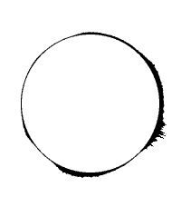

<!-- Generated by scripts/update_app_directory.py: do not edit by hand -->
[← All Pebble Developers](../developers.md)

# richh

*1 watchface · Last updated 2026-10-11 · [About these lists](../about-app-lists.md)*

Links: [Pebble App Store](https://apps.repebble.com/apps/dev/richh_ea22cf01488a101ad8c00794) · [GitHub (horstf)](https://github.com/horstf)

<h2 class="app-name" id="app-6a4b5a7435ef42609eedfe72"><a href="https://apps.repebble.com/6a4b5a7435ef42609eedfe72">Divergence</a> v1.0.2</h2>
<a class="app-source" href="https://github.com/horstf/divergence" title="Source code" data-search-exclude>View source</a>

Watchface

Released 2026-10-09 Updated 2026-10-09

Runs on: Round 2, Time 2, Pebble 2 Duo

A living eclipse on your wrist, inspired by the watch Serac wears in Westworld and by astosia&#x27;s Eclipse watchface. The ring around the disc changes every minute. Storms of &quot;divergence&quot; build at a…

