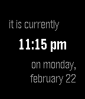

<!-- Generated by scripts/update_app_directory.py: do not edit by hand -->
[← All Pebble Developers](../developers.md)

# Rick Lewis

*1 watchface · Last updated 2026-10-11 · [About these lists](../about-app-lists.md)*

Links: [Pebble App Store](https://apps.repebble.com/apps/dev/rick-lewis_5541bb8d25cbe39ea900003e) · [GitHub (kid-c-plus)](https://github.com/kid-c-plus)

<h2 class="app-name" id="app-56cbe864dba61e0fb600000d"><a href="https://apps.repebble.com/56cbe864dba61e0fb600000d">Life Timer</a> v1.0</h2>
<a class="app-source" href="https://github.com/kid-c-plus/LifeTimer" title="Source code" data-search-exclude>View source</a>

Watchface

Released 2016-02-23 Updated 2016-02-23

Runs on: Round 2, Time 2, Pebble 2 Duo, Pebble 2, Time Round, Time, Classic

Most of the times I check my watch, I don&#x27;t really want to know the time. I just want to know how long it&#x27;s been since the last time I checked my watch. This watchface helps with that. The default…

