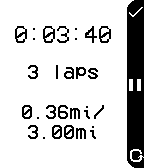

<!-- Generated by scripts/update_app_directory.py: do not edit by hand -->
[← All Pebble Developers](../developers.md)

# rickyman20

*1 app · Last updated 2026-10-11 · [About these lists](../about-app-lists.md)*

Links: [Pebble App Store](https://apps.repebble.com/apps/dev/rickyman20_52cdcc33ad26b45b09000013) · [GitHub (rickyman20)](https://github.com/rickyman20)

<h2 class="app-name" id="app-54ad8b9d32203eb1200000b3"><a href="https://apps.repebble.com/54ad8b9d32203eb1200000b3">Pebble Runner</a> v1.0</h2>
<a class="app-source" href="https://github.com/rickyman20/PocketRunnerPebble" title="Source code" data-search-exclude>View source</a>

App

Released 2015-01-07 Updated 2015-01-07

Runs on: Time 2, Pebble 2 Duo, Pebble 2, Time, Classic

NOTE: THIS APP IS ONLY COMPATIBLE WITH ANDROID A simple app for all your lap-keeping needs! This watch app lets you keep a track-record of your runs, by acting much like a chronometer. The run…

