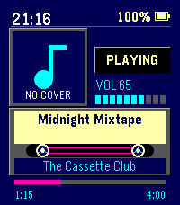

<!-- Generated by scripts/update_app_directory.py: do not edit by hand -->
[← All Pebble Developers](../developers.md)

# Rien

*1 app · Last updated 2026-11-16 · [About these lists](../about-app-lists.md)*

Links: [Pebble App Store](https://apps.repebble.com/apps/dev/rien_b4b76793bd950b565b05f4fc)

<h2 class="app-name" id="app-10e5f2c513824026bd22041e"><a href="https://apps.repebble.com/10e5f2c513824026bd22041e">TapePlayer</a> v1.8.0</h2>
<a class="app-source" href="https://git.christophermissick.com/chris/TapePlayer" title="Source code" data-search-exclude>View source</a>

App

Released 2026-11-13 Updated 2026-11-13

Runs on: Time 2

A cassette-style music remote for Pebble Time 2, with album artwork, playback controls, volume and track progress.

