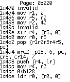
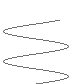
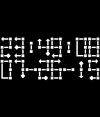

<!-- Generated by scripts/update_app_directory.py: do not edit by hand -->
[← All Pebble Developers](../developers.md)

# rigel314

*3 watchfaces and 2 apps · Last updated 2026-10-12 · [About these lists](../about-app-lists.md)*

Links: [Pebble App Store](https://apps.repebble.com/apps/dev/rigel314_529aa0fad17b50707b00001d) · [GitHub (rigel314)](https://github.com/rigel314) · [Website (computingeureka.com)](http://computingeureka.com)

<button type="button" data-filter="all" aria-pressed="true">All 5</button><button type="button" data-filter="watchface" aria-pressed="false">Watchfaces 3</button><button type="button" data-filter="watchapp" aria-pressed="false">Apps 2</button>

<label class="dev-sort">Sort by <select><option value="updated">Recently updated</option><option value="released">Newest release</option><option value="title">A–Z</option></select></label>

<h2 class="app-name" id="app-529aa8d5d17b5078d7000025"><a href="https://apps.repebble.com/529aa8d5d17b5078d7000025">System Info</a> v2.2</h2>
<a class="app-source" href="https://github.com/rigel314/pebbleSystemInfo" title="Source code" data-search-exclude>View source</a>

App

Released 2013-12-01 Updated 2015-08-16

Runs on: Time 2, Pebble 2 Duo, Pebble 2, Time, Classic

Hexeditor and Disassembler for your watch. This is a DANGEROUS tool, not a toy. Be careful with it. Misuse could brick your Pebble. Some areas of memory are not allowed to be read. If you try, the…

<h2 class="app-name" id="app-5300d1fdd1653b1dec0000b1"><a href="https://apps.repebble.com/5300d1fdd1653b1dec0000b1">Chordinator</a> v2.2</h2>
<a class="app-source" href="https://github.com/rigel314/pebbleChordinator" title="Source code" data-search-exclude>View source</a>

App

Released 2014-02-16 Updated 2015-06-25

Runs on: Time 2, Pebble 2 Duo, Pebble 2, Time, Classic

Displays guitar chord finger positions. Now shows chords for ukulele and piano too! This data in this app was found by searching Google for chords. The chords may be entirely wrong. If you find an…

<h2 class="app-name" id="app-52cb4b946e5f703b140000aa"><a href="https://apps.repebble.com/52cb4b946e5f703b140000aa">TextWatch24</a> v2.1.3</h2>
<a class="app-source" href="https://github.com/rigel314/pebbleTextWatch24" title="Source code" data-search-exclude>View source</a>

Watchface

Released 2014-01-07 Updated 2014-03-03

Runs on: Time 2, Pebble 2 Duo, Pebble 2, Time, Classic

Displays the time like the default text watch, but in 24 hour time. Has options for showing the date and the display for a leading zero in the minutes. &quot; oh &quot; or &quot; o&#x27; &quot;. The watchface animates a…

<h2 class="app-name" id="app-529aad25d17b501dcd00002b"><a href="https://apps.repebble.com/529aad25d17b501dcd00002b">Sine Wave</a> v2.0.0</h2>
<a class="app-source" href="https://github.com/rigel314/pebbleSineWatch" title="Source code" data-search-exclude>View source</a>

Watchface

Released 2013-12-01 Updated 2014-02-04

Runs on: Time 2, Pebble 2 Duo, Pebble 2, Time, Classic

To read: The number of nodes is the number of hours. At one o&#x27;clock, there is only half a cycle showing. The number of minutes is shown by looking at the top end of the wave. The antinodes are 30…

<h2 class="app-name" id="app-529aab4a16952349bb000027"><a href="https://apps.repebble.com/529aab4a16952349bb000027">Antichamber</a> v2.0.0</h2>
<a class="app-source" href="https://github.com/rigel314/pebbleAntichamber" title="Source code" data-search-exclude>View source</a>

Watchface

Released 2013-12-01 Updated 2014-02-04

Runs on: Time 2, Pebble 2 Duo, Pebble 2, Time, Classic

A Pebble watchface inspired by the map in the amazing game, Antichamber.

