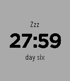

<!-- Generated by scripts/update_app_directory.py: do not edit by hand -->
[← All Pebble Developers](../developers.md)

# rileyjshaw

*1 watchface · Last updated 2026-10-12 · [About these lists](../about-app-lists.md)*

Links: [Pebble App Store](https://apps.repebble.com/apps/dev/rileyjshaw_52f0ac2aaf0eab128400242c) · [GitHub (rileyjshaw)](https://github.com/rileyjshaw)

<h2 class="app-name" id="app-54cadfd211e375bdc5000048"><a href="https://apps.repebble.com/54cadfd211e375bdc5000048">28 Hour Day</a> v1.0</h2>
<a class="app-source" href="https://github.com/rileyjshaw/28-hour-day-pebble" title="Source code" data-search-exclude>View source</a>

Watchface

Released 2015-01-30 Updated 2015-01-30

Runs on: Time 2, Pebble 2 Duo, Pebble 2, Time, Classic

Wake up early on weekdays. Stay up late on weekends. Sleep 9 hours a night and fit an extra 3 hours into each day. This watchface divides the week into six 28-hour days instead of the standard…

