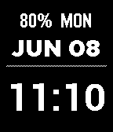

<!-- Generated by scripts/update_app_directory.py: do not edit by hand -->
[← All Pebble Developers](../developers.md)

# ringmaster.dev

*1 watchface · Last updated 2026-10-11 · [About these lists](../about-app-lists.md)*

Links: [Pebble App Store](https://apps.repebble.com/apps/dev/ringmaster-dev_0f5402df104c29e3eafaf06a) · [GitHub (ringmaster-dev)](https://github.com/ringmaster-dev)

<h2 class="app-name" id="app-d3caf8be543e4cb084c48509"><a href="https://apps.repebble.com/d3caf8be543e4cb084c48509">ReadyToRead</a> v1.0.1</h2>
<a class="app-source" href="https://github.com/ringmaster-dev/ReadyToRead" title="Source code" data-search-exclude>View source</a>

Watchface

Released 2026-06-07 Updated 2026-06-10

Runs on: Round 2, Time 2, Pebble 2 Duo, Pebble 2, Time Round, Time, Classic

Watchface designed for easy readability.

