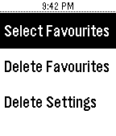
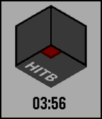

<!-- Generated by scripts/update_app_directory.py: do not edit by hand -->
[← All Pebble Developers](../developers.md)

# Rishie

*1 watchface and 1 app · Last updated 2026-10-12 · [About these lists](../about-app-lists.md)*

Links: [Pebble App Store](https://apps.repebble.com/apps/dev/rishie_537ff1f561e8e220bb000006) · [GitHub (PebbleKat)](https://github.com/PebbleKat) · [GitHub (codemonkey9000)](https://github.com/codemonkey9000) · [Website (lockitron.com)](https://lockitron.com/)

<button type="button" data-filter="all" aria-pressed="true">All 2</button><button type="button" data-filter="watchface" aria-pressed="false">Watchfaces 1</button><button type="button" data-filter="watchapp" aria-pressed="false">Apps 1</button>

<label class="dev-sort">Sort by <select><option value="updated">Recently updated</option><option value="released">Newest release</option><option value="title">A–Z</option></select></label>

<h2 class="app-name" id="app-569991c86f0a1b4c23000070"><a href="https://apps.repebble.com/569991c86f0a1b4c23000070">Lockitron for Pebble</a> v1</h2>
<a class="app-source" href="https://github.com/PebbleKat/Lockitron-for-Pebble" title="Source code" data-search-exclude>View source</a>

App

MIT Released 2016-01-16 Updated 2016-01-20

Runs on: Round 2, Time 2, Pebble 2 Duo, Pebble 2, Time Round, Time, Classic

Control any of your Lockitron locks right from your wrist! Choose favorite locks to keep on the main menu for easy access. Works with all Lockitron products. Requires authentication only on first…

<h2 class="app-name" id="app-5567c6b63c5595f7c4000095"><a href="https://apps.repebble.com/5567c6b63c5595f7c4000095">HITB</a> v1.1</h2>
<a class="app-source" href="http://www.github.com/codemonkey9000/HITB" title="Source code" data-search-exclude>View source</a>

Watchface

No licence Released 2015-05-29 Updated 2015-12-17

Runs on: Round 2, Time 2, Pebble 2 Duo, Pebble 2, Time Round, Time, Classic

Watchface made for the awesome folks at Hack in the Box.

