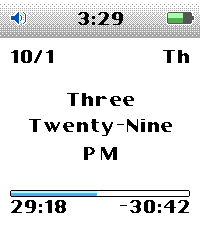

<!-- Generated by scripts/update_app_directory.py: do not edit by hand -->
[← All Pebble Developers](../developers.md)

# River Wang

*1 watchface · Last updated 2026-10-12 · [About these lists](../about-app-lists.md)*

Links: [Pebble App Store](https://apps.repebble.com/apps/dev/river-wang_497c545198436388c9960e44) · [GitHub (urfdvw)](https://github.com/urfdvw)

<h2 class="app-name" id="app-94f77dc0f1a64d2da7c9bc3e"><a href="https://apps.repebble.com/94f77dc0f1a64d2da7c9bc3e">Poddle</a> v1.0.4</h2>
<a class="app-source" href="https://github.com/urfdvw/poddle" title="Source code" data-search-exclude>View source</a>

Watchface · <a href="https://forum.rebble.io/t/1396" title="Discuss this app on the Rebble forum" data-search-exclude>Forum thread</a>

Released 2026-10-01 Updated 2026-10-03

Runs on: Time 2, Pebble 2 Duo, Pebble 2, Time, Classic

The watch face that takes you back to 2004. The progress bar can display: - Progress through the current hour - Progress through the current minute - Progress through a custom time period - Daily…

