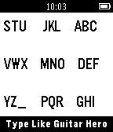

<!-- Generated by scripts/update_app_directory.py: do not edit by hand -->
[← All Pebble Developers](../developers.md)

# Rmesquita

*1 app · Last updated 2026-10-12 · [About these lists](../about-app-lists.md)*

Links: [Pebble App Store](https://apps.repebble.com/apps/dev/rmesquita_536a8ef0749b902160000022) · [GitHub (rmesquit)](https://github.com/rmesquit)

<h2 class="app-name" id="app-54f3398f2af981c827000058"><a href="https://apps.repebble.com/54f3398f2af981c827000058">HeroBoard</a> v1.0</h2>
<a class="app-source" href="https://github.com/rmesquit/HeroBoard" title="Source code" data-search-exclude>View source</a>

App

Released 2015-03-01 Updated 2015-03-03

Runs on: Time 2, Pebble 2 Duo, Pebble 2, Time, Classic

Demo for developers: Guitar Hero based keyboard compatible with t3/t9 text prediction algorithms.

