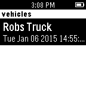

<!-- Generated by scripts/update_app_directory.py: do not edit by hand -->
[← All Pebble Developers](../developers.md)

# Rob Chartier

*1 app · Last updated 2026-10-12 · [About these lists](../about-app-lists.md)*

Links: [Pebble App Store](https://apps.repebble.com/apps/dev/rob-chartier_54a7283e4517d074890000e1) · [GitHub (mojio)](https://github.com/mojio) · [Website (moj.io)](http://moj.io)

<h2 class="app-name" id="app-54ac712b75975b92b2000057"><a href="https://apps.repebble.com/54ac712b75975b92b2000057">Mojio spot</a> v1.0</h2>
<a class="app-source" href="https://github.com/mojio/mojio.pebble" title="Source code" data-search-exclude>View source</a>

App

Released 2015-01-06 Updated 2015-01-06

Runs on: Time 2, Pebble 2 Duo, Pebble 2, Time, Classic

Find the distance, walking directions, fuel level, to your moj.io enabled vehicle all from your watch!

