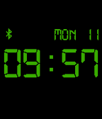
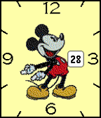
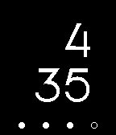

<!-- Generated by scripts/update_app_directory.py: do not edit by hand -->
[← All Pebble Developers](../developers.md)

# Rob Garth

*4 watchfaces · Last updated 2026-10-11 · [About these lists](../about-app-lists.md)*

Links: [Pebble App Store](https://apps.repebble.com/apps/dev/rob-garth_52f1fc5b7247497b640000dc) · [Rebble App Store](https://apps.rebble.io/en_US/developer/52f1fc5b7247497b640000dc/1) · [GitHub (rgarth)](https://github.com/rgarth)

<button type="button" data-filter="all" aria-pressed="true">All 4</button><button type="button" data-filter="watchface" aria-pressed="false">Watchfaces 4</button><button type="button" data-filter="watchapp" aria-pressed="false" disabled>Apps 0</button>

<label class="dev-sort">Sort by <select><option value="updated">Recently updated</option><option value="released">Newest release</option><option value="title">A–Z</option></select></label>

<h2 class="app-name" id="app-5547cb2a85905014430000a5"><a href="https://apps.repebble.com/5547cb2a85905014430000a5">Digital Power</a> v1.3</h2>
<a class="app-source" href="https://github.com/rgarth/PebbleDigitalPower" title="Source code" data-search-exclude>View source</a>

Watchface

Released 2015-05-04 Updated 2017-11-14

Runs on: Time 2, Time

LCD/Alarm-Clock inspired watch-face. Color can either change depending on battery power (Green/Orange/Red), or it can be configured to any of the 64 colors available on the Pebble Time.

<h2 class="app-name" id="app-54ed0fceb5dab64c3f000106"><a href="https://apps.repebble.com/54ed0fceb5dab64c3f000106">Close enough</a> v3.9</h2>
<a class="app-source" href="https://github.com/rgarth/PebbleCloseEnough" title="Source code" data-search-exclude>View source</a>

Watchface

Released 2015-02-24 Updated 2016-08-25

Runs on: Time 2, Pebble 2 Duo, Pebble 2, Time, Classic

Human readable watch-face which gives the time in increments of five minutes. Tells the time the same way that you do. Shake/Tap to wake-up. Accurate, digital time will then be displayed, followed…

<h2 class="app-name" id="app-55592159b038d48f6e000040"><a href="https://apps.repebble.com/55592159b038d48f6e000040">Mouseketeer</a> v1.4</h2>
<a class="app-source" href="https://github.com/rgarth/PebbleMouse" title="Source code" data-search-exclude>View source</a>

Watchface

Released 2015-05-17 Updated 2015-05-28

Runs on: Time 2, Time

A color Mickey Mouse watch-face

<h2 class="app-name" id="app-5500d5d0b5bebe8eba00007b"><a href="https://apps.rebble.io/en_US/application/5500d5d0b5bebe8eba00007b">P-Time</a> v1.2</h2>
<a class="app-source" href="http://github.com/rgarth/PebbleP-Time" title="Source code" data-search-exclude>View source</a>

Watchface

MIT Released 2015-03-11 Updated 2015-04-20 Rebble App Store

Runs on: Time 2, Pebble 2 Duo, Pebble 2, Time, Classic

Another watch-face that simply shows the time and Pebble&#x27;s current battery level.

