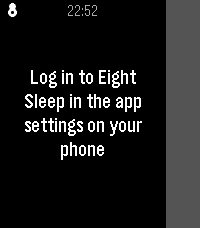

<!-- Generated by scripts/update_app_directory.py: do not edit by hand -->
[← All Pebble Developers](../developers.md)

# Robbe Derks

*1 app · Last updated 2026-10-12 · [About these lists](../about-app-lists.md)*

Links: [Pebble App Store](https://apps.repebble.com/apps/dev/robbe-derks_646e91cc5f8258082f14349a) · [GitHub (robbederks)](https://github.com/robbederks)

<h2 class="app-name" id="app-b91051fbb0564e9abd2d5a6f"><a href="https://apps.repebble.com/b91051fbb0564e9abd2d5a6f">Eight Pebbles</a> v1.0.0</h2>
<a class="app-source" href="https://github.com/robbederks/eight-pebbles" title="Source code" data-search-exclude>View source</a>

App

Released 2026-06-10 Updated 2026-06-10

Runs on: Time 2

Control your Eight Sleep mattress from your wrist. Designed around one use case: nudging the bed temperature at 3am without reaching for your phone.

