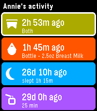
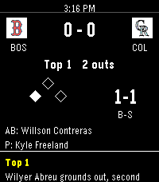

<!-- Generated by scripts/update_app_directory.py: do not edit by hand -->
[← All Pebble Developers](../developers.md)

# RobErskine

*3 apps · Last updated 2026-10-12 · [About these lists](../about-app-lists.md)*

Links: [Pebble App Store](https://apps.repebble.com/apps/dev/roberskine_184b13a8b0e0be736034d50a) · [GitHub (RobErskine)](https://github.com/RobErskine)

<button type="button" data-filter="all" aria-pressed="true">All 3</button><button type="button" data-filter="watchface" aria-pressed="false" disabled>Watchfaces 0</button><button type="button" data-filter="watchapp" aria-pressed="false">Apps 3</button>

<label class="dev-sort">Sort by <select><option value="updated">Recently updated</option><option value="released">Newest release</option><option value="title">A–Z</option></select></label>

<h2 class="app-name" id="app-7fd2ec0472eb43a589c03d7a"><a href="https://apps.repebble.com/7fd2ec0472eb43a589c03d7a">Huckleberry</a> v1.1.0</h2>
<a class="app-source" href="https://github.com/RobErskine/pebble-huckleberry" title="Source code" data-search-exclude>View source</a>

App

MIT Released 2026-07-15 Updated 2026-07-16

Runs on: Round 2, Time 2, Pebble 2 Duo, Pebble 2, Time Round, Time, Classic

See your children&#x27;s latest logs from Huckleberry so you can always stay on top of diaper changes and upcoming bottle feedings.

<h2 class="app-name" id="app-036fa1ce71bf44f991e9228c"><a href="https://apps.repebble.com/036fa1ce71bf44f991e9228c">Chimer</a> v1.2.0</h2>
<a class="app-source" href="https://github.com/RobErskine/pebble-chimer" title="Source code" data-search-exclude>View source</a>

App

No licence Released 2026-06-20 Updated 2026-07-15

Runs on: Round 2, Time 2, Pebble 2 Duo, Pebble 2, Time Round, Time, Classic

Inspired by Casio watches as well as the Sensor and Ollee Watch mods, Chimers brings back classic hourly beeps with more customization. Specify days of the week, hour ranges, optional half-hour…

<h2 class="app-name" id="app-99bfa7344bcb48179e60dfb6"><a href="https://apps.repebble.com/99bfa7344bcb48179e60dfb6">MLB Scores</a> v1.1.1</h2>
<a class="app-source" href="https://github.com/RobErskine/pebble-mlb-scores" title="Source code" data-search-exclude>View source</a>

App

No licence Released 2026-06-25 Updated 2026-07-01

Runs on: Round 2, Time 2, Pebble 2 Duo, Pebble 2, Time Round, Time, Classic

MLB Gameday on your wrist. See all games, their current inning, and their scores. Drill into any game to see the pitcher, active hitter, and their count down to the current balls and strikes. See…

