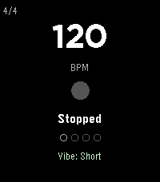

<!-- Generated by scripts/update_app_directory.py: do not edit by hand -->
[← All Pebble Developers](../developers.md)

# Robert Haist

*1 app · Last updated 2026-10-12 · [About these lists](../about-app-lists.md)*

Links: [Pebble App Store](https://apps.repebble.com/apps/dev/robert-haist_4c449704e339662b0abb6af1) · [GitHub (rhaist)](https://github.com/rhaist)

<h2 class="app-name" id="app-88e1ab6a7e1b45559a5023e1"><a href="https://apps.repebble.com/88e1ab6a7e1b45559a5023e1">Pulse Metronome</a> v1.2.0</h2>
<a class="app-source" href="https://github.com/rhaist/pebble-pulse" title="Source code" data-search-exclude>View source</a>

App

Released 2026-04-04 Updated 2026-07-14

Runs on: Round 2, Time 2, Pebble 2 Duo, Pebble 2, Time Round, Time, Classic

A clean, precise metronome for Pebble smartwatches.

