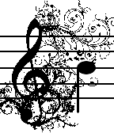

<!-- Generated by scripts/update_app_directory.py: do not edit by hand -->
[← All Pebble Developers](../developers.md)

# Robert Ying

*1 app · Last updated 2026-10-11 · [About these lists](../about-app-lists.md)*

Links: [Pebble App Store](https://apps.repebble.com/apps/dev/robert-ying_52feabb13085a05a4b0004ae) · [GitHub (rbtying)](https://github.com/rbtying) · [Website (getpebblin.com)](http://getpebblin.com)

<h2 class="app-name" id="app-532b66bcda514ee90000001d"><a href="https://apps.repebble.com/532b66bcda514ee90000001d">Pebblin</a> v1.0.1</h2>
<a class="app-source" href="http://github.com/rbtying/pebblelin" title="Source code" data-search-exclude>View source</a>

App

No licence Released 2014-03-20 Updated 2014-03-20

Runs on: Time 2, Pebble 2 Duo, Pebble 2, Time, Classic

Pebblin&#x27; is an air violin developed on a Pebble smartwatch and an Android smartphone. Here, the Pebble acts as the &quot;bow&quot; for the violin, while the phone acts as a &quot;fret&quot;. The angle of the watch…

