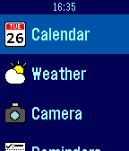
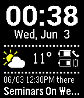

<!-- Generated by scripts/update_app_directory.py: do not edit by hand -->
[← All Pebble Developers](../developers.md)

# robhh

*2 apps · Last updated 2026-10-12 · [About these lists](../about-app-lists.md)*

Links: [Rebble App Store](https://apps.rebble.io/en_US/developer/5283fe46c0b016202300001b/1) · [GitHub (robhh)](https://github.com/robhh) · [Website (smartwatchplusios.appspot.com)](http://smartwatchplusios.appspot.com)

<button type="button" data-filter="all" aria-pressed="true">All 2</button><button type="button" data-filter="watchface" aria-pressed="false" disabled>Watchfaces 0</button><button type="button" data-filter="watchapp" aria-pressed="false">Apps 2</button>

<label class="dev-sort">Sort by <select><option value="updated">Recently updated</option><option value="released">Newest release</option><option value="title">A–Z</option></select></label>

<h2 class="app-name" id="app-52f0573d1ac7949119001518"><a href="https://apps.rebble.io/en_US/application/52f0573d1ac7949119001518">Smartwatch+</a> v1.91</h2>
<a class="app-source" href="http://github.com/robhh/SmartStatus-AppStore" title="Source code" data-search-exclude>View source</a>

App

No licence Released 2014-02-04 Updated 2015-06-07 Rebble App Store

Runs on: Time 2, Pebble 2 Duo, Pebble 2, Time, Classic

Smartwatch+ allows you to display additional information on your watch, such as weather, your iPhone&#x27;s battery status, current stock and Bitcoin prices, your current GPS location, your latest…

<h2 class="app-name" id="app-528fc3f5a92e1fb5ac000019"><a href="https://apps.rebble.io/en_US/application/528fc3f5a92e1fb5ac000019">SmartStatus</a> v1.9</h2>
<a class="app-source" href="http://github.com/robhh/SmartStatus-AppStore" title="Source code" data-search-exclude>View source</a>

App

No licence Released 2013-11-22 Updated 2015-06-03 Rebble App Store

Runs on: Time 2, Pebble 2 Duo, Pebble 2, Time, Classic

Display the current weather alongside the iPhone&#x27;s and Pebble&#x27;s battery level, the current/next calendar appointment, and the currently playing song from your iPhone&#x27;s iPod music player. This…

