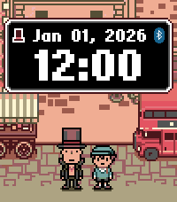

<!-- Generated by scripts/update_app_directory.py: do not edit by hand -->
[← All Pebble Developers](../developers.md)

# robinfire110

*2 watchfaces and 1 app · Last updated 2026-10-12 · [About these lists](../about-app-lists.md)*

Links: [Pebble App Store](https://apps.repebble.com/apps/dev/robinfire110_5ba43f96fb18c4000121d57b) · [GitHub (robinfire110)](https://github.com/robinfire110)

<button type="button" data-filter="all" aria-pressed="true">All 3</button><button type="button" data-filter="watchface" aria-pressed="false">Watchfaces 2</button><button type="button" data-filter="watchapp" aria-pressed="false">Apps 1</button>

<label class="dev-sort">Sort by <select><option value="updated">Recently updated</option><option value="released">Newest release</option><option value="title">A–Z</option></select></label>

<h2 class="app-name" id="app-63ed5e8319ed6a00090984a1"><a href="https://apps.repebble.com/63ed5e8319ed6a00090984a1">Professor Layton - Mini London</a> v1.5.0</h2>
<a class="app-source" href="https://github.com/robinfire110/layton-watchface" title="Source code" data-search-exclude>View source</a>

Watchface · <a href="https://forum.rebble.io/t/267" title="Discuss this app on the Rebble forum" data-search-exclude>Forum thread</a>

Released 2023-02-15 Updated 2026-07-19

Runs on: Round 2, Time 2, Pebble 2 Duo, Pebble 2, Time Round, Time

Professor Layton – Mini London brings the world of Professor Layton to your wrist! Set on the streets of London, choose from more than 20 characters across the Professor Layton series to appear…

<h2 class="app-name" id="app-67c648a1b7a02300092ba0c8"><a href="https://apps.repebble.com/67c648a1b7a02300092ba0c8">Nintendo Switch 2</a> v1.4.0</h2>
<a class="app-source" href="https://github.com/robinfire110/switch-2-watchface" title="Source code" data-search-exclude>View source</a>

Watchface · <a href="https://forum.rebble.io/t/266" title="Discuss this app on the Rebble forum" data-search-exclude>Forum thread</a>

Released 2025-03-04 Updated 2026-07-19

Runs on: Round 2, Time 2, Pebble 2 Duo, Pebble 2, Time Round, Time, Classic

Made in celebration of the 8 year anniversary of the Nintendo Switch for the Rebble Hackathon #002. Originally, a watchface to count down to the system&#x27;s release, it has been updated to just be a…

<h2 class="app-name" id="app-64177b1e419fd9053e31a7b5"><a href="https://apps.repebble.com/64177b1e419fd9053e31a7b5">Koishi - Japanese Kana Flashcards</a> v1.3.0</h2>
<a class="app-source" href="https://github.com/robinfire110/koishi-japanese-flashcards" title="Source code" data-search-exclude>View source</a>

App · <a href="https://forum.rebble.io/t/265" title="Discuss this app on the Rebble forum" data-search-exclude>Forum thread</a>

Released 2023-03-19 Updated 2026-07-19

Runs on: Round 2, Time 2, Pebble 2 Duo, Pebble 2, Time Round, Time, Classic

Koishi is a flashcard application that gives you a full set of Japanese Hiragana and Katakana flashcards right on your wrist! Study your kana recognition anytime, anywhere! - Support for all…

