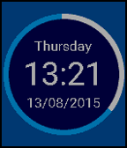
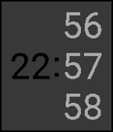

<!-- Generated by scripts/update_app_directory.py: do not edit by hand -->
[← All Pebble Developers](../developers.md)

# Robinhuett

*2 watchfaces · Last updated 2026-10-11 · [About these lists](../about-app-lists.md)*

Links: [Pebble App Store](https://apps.repebble.com/apps/dev/robinhuett_54f42ba389900eb9a2000036) · [GitHub (Robinhuett)](https://github.com/Robinhuett)

<button type="button" data-filter="all" aria-pressed="true">All 2</button><button type="button" data-filter="watchface" aria-pressed="false">Watchfaces 2</button><button type="button" data-filter="watchapp" aria-pressed="false" disabled>Apps 0</button>

<label class="dev-sort">Sort by <select><option value="updated">Recently updated</option><option value="released">Newest release</option><option value="title">A–Z</option></select></label>

<h2 class="app-name" id="app-55cc84672033826bd2000004"><a href="https://apps.repebble.com/55cc84672033826bd2000004">Circumflexus</a> v1.01</h2>
<a class="app-source" href="https://github.com/Robinhuett/Circumflexus" title="Source code" data-search-exclude>View source</a>

Watchface

MIT Released 2015-08-13 Updated 2025-12-01

Runs on: Time 2, Time

Watchface for Pebble Time. This is based on the design of TimeDrol from X.adA but with a varity of options like fully customizable colors and an dinamcly filling circle.

<h2 class="app-name" id="app-55829887389bcc0b0f00007c"><a href="https://apps.repebble.com/55829887389bcc0b0f00007c">SoliTime</a> v1.21</h2>
<a class="app-source" href="https://github.com/Robinhuett/SoliTime" title="Source code" data-search-exclude>View source</a>

Watchface

No licence Released 2015-06-18 Updated 2025-11-25

Runs on: Time 2, Pebble 2 Duo, Pebble 2, Time, Classic

SoliTime is a minimalistic watchface based on an image from Googles presentation of project Soli. Update 1.2 - Added color configuration. You can now choose all colors independently! - Added…

