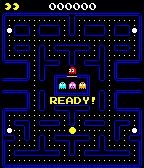
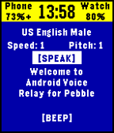

<!-- Generated by scripts/update_app_directory.py: do not edit by hand -->
[← All Pebble Developers](../developers.md)

# robisodd

*4 apps · Last updated 2026-10-11 · [About these lists](../about-app-lists.md)*

Links: [Pebble App Store](https://apps.repebble.com/apps/dev/robisodd_530273b74b130b71ef000192) · [GitHub (robisodd)](https://github.com/robisodd) · [Website (reddit.com)](http://reddit.com/r/pebble/comments/2jn888/)

<button type="button" data-filter="all" aria-pressed="true">All 4</button><button type="button" data-filter="watchface" aria-pressed="false" disabled>Watchfaces 0</button><button type="button" data-filter="watchapp" aria-pressed="false">Apps 4</button>

<label class="dev-sort">Sort by <select><option value="updated">Recently updated</option><option value="released">Newest release</option><option value="title">A–Z</option></select></label>

<h2 class="app-name" id="app-56e96a786214ffd83400000b"><a href="https://apps.repebble.com/56e96a786214ffd83400000b">Pixel Muncher v0.6 alpha</a> v0.6</h2>
<a class="app-source" href="https://github.com/robisodd/PixelMuncher0.6" title="Source code" data-search-exclude>View source</a>

App

Released 2016-03-16 Updated 2016-07-15

Runs on: Time 2, Pebble 2 Duo, Pebble 2, Time, Classic

Pixel Muncher - Version 0.6 Alpha Controls: Up - Turn Left Down - Turn Right Select - Reverse Back - Pause (Back again to Exit) Not ready for release. Still much to do.

<h2 class="app-name" id="app-545916455a7e52713b000075"><a href="https://apps.repebble.com/545916455a7e52713b000075">BPM Detector</a> v1.1</h2>
<a class="app-source" href="https://github.com/robisodd/bpm_detector" title="Source code" data-search-exclude>View source</a>

App

Released 2014-11-04 Updated 2016-03-29

Runs on: Round 2, Time 2, Pebble 2 Duo, Pebble 2, Time Round, Time, Classic

Simple BPM detector. Tap on the Pebble&#x27;s face (or tap on the table with the hand the watch is on) to get the beats per minute of your taps. Press the select button to change the sensitivity (how…

<h2 class="app-name" id="app-56e46269b7a6019d4700001c"><a href="https://apps.repebble.com/56e46269b7a6019d4700001c">Voice 🎤 Relay</a> v1.0</h2>
<a class="app-source" href="https://github.com/robisodd/VoiceRelay" title="Source code" data-search-exclude>View source</a>

App

Released 2016-03-12 Updated 2016-03-12

Runs on: Round 2, Time 2, Pebble 2 Duo, Pebble 2, Time Round, Time, Classic

Allows you to remotely make your phone talk or make BEEP noises. Good for a phone finder or phone locator to find your phone find phone or scare your dog. No companion app required! Only works on…

<h2 class="app-name" id="app-557ed8733c562e76c5000021"><a href="https://apps.repebble.com/557ed8733c562e76c5000021">Arena3D</a> v0.12</h2>
<a class="app-source" href="https://github.com/robisodd/Arena3D-v0.10" title="Source code" data-search-exclude>View source</a>

App

Released 2015-06-15 Updated 2015-07-02

Runs on: Time 2, Pebble 2 Duo, Pebble 2, Time, Classic

A simple Doom or Wolfenstein like 3D raycaster. There is no goal or objective, just walking around and seeing the Pebble&#x27;s ability to render a 3D game. Use the accelerometer to move. To remain…

