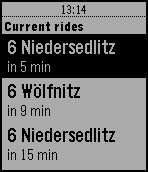

<!-- Generated by scripts/update_app_directory.py: do not edit by hand -->
[← All Pebble Developers](../developers.md)

# roboresistance.com

*1 app · Last updated 2026-10-11 · [About these lists](../about-app-lists.md)*

Links: [Pebble App Store](https://apps.repebble.com/apps/dev/roboresistance-com_551822068b7de558730000be) · [GitHub (iherzdresden)](https://github.com/iherzdresden) · [Website (iherzdresden.github.io)](https://iherzdresden.github.io/dvb-trinity/)

<h2 class="app-name" id="app-57594fd19bcb70b5bf000014"><a href="https://apps.repebble.com/57594fd19bcb70b5bf000014">DVB Trinity</a> v0.4</h2>
<a class="app-source" href="https://github.com/iherzdresden/dvb-trinity-pebble" title="Source code" data-search-exclude>View source</a>

App

Released 2016-06-09 Updated 2016-09-26

Runs on: Round 2, Time 2, Time Round, Time

Displays DVB rides from the Trinitatisplatz station in Dresden

