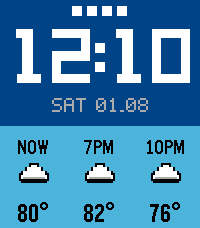
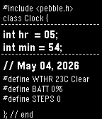

<!-- Generated by scripts/update_app_directory.py: do not edit by hand -->
[← All Pebble Developers](../developers.md)

# RockenSocken

*2 watchfaces · Last updated 2026-10-11 · [About these lists](../about-app-lists.md)*

Links: [Pebble App Store](https://apps.repebble.com/apps/dev/rockensocken_02d8d4c1aec6e5aa9ca3f104) · [GitHub (RockenSocken)](https://github.com/RockenSocken)

<button type="button" data-filter="all" aria-pressed="true">All 2</button><button type="button" data-filter="watchface" aria-pressed="false">Watchfaces 2</button><button type="button" data-filter="watchapp" aria-pressed="false" disabled>Apps 0</button>

<label class="dev-sort">Sort by <select><option value="updated">Recently updated</option><option value="released">Newest release</option><option value="title">A–Z</option></select></label>

<h2 class="app-name" id="app-72b2c8a3f46d4cc88d2c74c4"><a href="https://apps.repebble.com/72b2c8a3f46d4cc88d2c74c4">Straight Forecast 2</a> v2.0.0</h2>
<a class="app-source" href="https://github.com/RockenSocken/StraightForcast2" title="Source code" data-search-exclude>View source</a>

Watchface

No licence Released 2026-08-01 Updated 2026-08-01

Runs on: Time 2

A complete redesign of the classic StraightForecast watchface by Tim Grant, built specifically for the Pebble Time 2. Features a custom bitmap clock, current weather, three-hour forecast…

<h2 class="app-name" id="app-43e75103ac5041c09beb33e6"><a href="https://apps.repebble.com/43e75103ac5041c09beb33e6">CodeTime</a> v1.3</h2>
<a class="app-source" href="https://github.com/RockenSocken/CodeTime" title="Source code" data-search-exclude>View source</a>

Watchface

No licence Released 2026-05-04 Updated 2026-05-04

Runs on: Time 2, Pebble 2 Duo, Pebble 2, Time, Classic

A code-inspired Pebble watchface displaying time, date, weather, battery, and step count. Designed for high-contrast readability with configurable 12/24-hour format and Celsius/Fahrenheit units…

