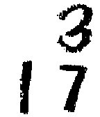

<!-- Generated by scripts/update_app_directory.py: do not edit by hand -->
[← All Pebble Developers](../developers.md)

# Roger Leblanc

*3 watchfaces · Last updated 2026-10-11 · [About these lists](../about-app-lists.md)*

Links: [Pebble App Store](https://apps.repebble.com/apps/dev/roger-leblanc_52b59af6d2b97a3c0a000016) · [GitHub (RodgerLeblanc)](https://github.com/RodgerLeblanc)

<button type="button" data-filter="all" aria-pressed="true">All 3</button><button type="button" data-filter="watchface" aria-pressed="false">Watchfaces 3</button><button type="button" data-filter="watchapp" aria-pressed="false" disabled>Apps 0</button>

<label class="dev-sort">Sort by <select><option value="updated">Recently updated</option><option value="released">Newest release</option><option value="title">A–Z</option></select></label>

<h2 class="app-name" id="app-57f8a6fa56fda5acf1000094"><a href="https://apps.repebble.com/57f8a6fa56fda5acf1000094">N2W</a> v1.21</h2>
<a class="app-source" href="https://github.com/RodgerLeblanc/N2W" title="Source code" data-search-exclude>View source</a>

Watchface

MIT Released 2016-10-08 Updated 2017-01-10

Runs on: Round 2, Time 2, Pebble 2 Duo, Pebble 2, Time Round, Time, Classic

Get your notification icons on your Pebble and stop glancing at your phone every 2 minutes to see if you have unread notifications. Supports all major social apps and many popular apps. Must be…

<h2 class="app-name" id="app-52b5da08d2b97a3efd000020"><a href="https://apps.repebble.com/52b5da08d2b97a3efd000020">Whiteboard</a> v2.7</h2>
<a class="app-source" href="https://github.com/RodgerLeblanc/Whiteboard" title="Source code" data-search-exclude>View source</a>

Watchface

No licence Released 2013-12-21 Updated 2014-02-02

Runs on: Time 2, Pebble 2 Duo, Pebble 2, Time, Classic

Simple whiteboard watchface that changes to a blackboard if bluetooth connection is lost. Comes with Quick Tap Plus installed : shake your wrist to see your Pebble&#x27;s battery life!

<h2 class="app-name" id="app-52b5a51020fef4a5c9000019"><a href="https://apps.repebble.com/52b5a51020fef4a5c9000019">Blackboard</a> v2.7</h2>
<a class="app-source" href="https://github.com/RodgerLeblanc/Blackboard" title="Source code" data-search-exclude>View source</a>

Watchface

No licence Released 2013-12-21 Updated 2014-02-02

Runs on: Time 2, Pebble 2 Duo, Pebble 2, Time, Classic

Simple blackboard watchface that changes to a whiteboard if bluetooth connection is lost. Comes with Quick Tap Plus installed : shake your wrist to see your Pebble&#x27;s battery life!

