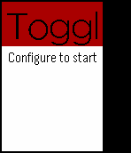

<!-- Generated by scripts/update_app_directory.py: do not edit by hand -->
[← All Pebble Developers](../developers.md)

# Rogier Slag

*1 app · Last updated 2026-10-12 · [About these lists](../about-app-lists.md)*

Links: [Pebble App Store](https://apps.repebble.com/apps/dev/rogier-slag_52f09529bb3423c584001e43) · [GitHub (rogierslag)](https://github.com/rogierslag)

<h2 class="app-name" id="app-53206fc7e271df5719000162"><a href="https://apps.repebble.com/53206fc7e271df5719000162">Toggle</a> v1.3</h2>
<a class="app-source" href="https://github.com/rogierslag/TogglAppPebble" title="Source code" data-search-exclude>View source</a>

App

Released 2014-03-12 Updated 2015-09-12

Runs on: Time 2, Pebble 2 Duo, Pebble 2, Time, Classic

You also love to use Toggl for your time keeping and would love to integrate that to your Pebble for easy billing and keeping track of everything? That&#x27;s what this app was created for. Simple…

