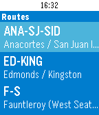

<!-- Generated by scripts/update_app_directory.py: do not edit by hand -->
[← All Pebble Developers](../developers.md)

# Rogoon

*1 app · Last updated 2026-10-12 · [About these lists](../about-app-lists.md)*

Links: [Pebble App Store](https://apps.repebble.com/apps/dev/rogoon_567c5d9f58ad4cce7200005d) · [GitHub (Rogoon)](https://github.com/Rogoon) · [Website (rogoon.github.io)](http://rogoon.github.io/WAFerriesPebble/)

<h2 class="app-name" id="app-57091fd38448d8e6e4000026"><a href="https://apps.repebble.com/57091fd38448d8e6e4000026">WA Ferries</a> v1.0</h2>
<a class="app-source" href="https://github.com/Rogoon/WAFerriesPebble" title="Source code" data-search-exclude>View source</a>

App

No licence Released 2016-04-09 Updated 2019-07-24

Runs on: Round 2, Time 2, Pebble 2 Duo, Pebble 2, Time Round, Time, Classic

Get departure times for all Washington State ferries on your Pebble. Check real-time alerts. Pin times to your timeline so you never forget! This app requires a Bluetooth and internet connection…

