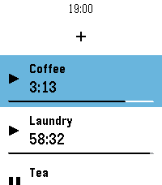

<!-- Generated by scripts/update_app_directory.py: do not edit by hand -->
[← All Pebble Developers](../developers.md)

# Rohit Gohri

*1 app · Last updated 2026-11-23 · [About these lists](../about-app-lists.md)*

Links: [Pebble App Store](https://apps.repebble.com/apps/dev/rohit-gohri_eb494b74106a27cd7191b2bd) · [GitHub (rohit-gohri)](https://github.com/rohit-gohri)

<h2 class="app-name" id="app-2c61c0e6622c46f9b4945843"><a href="https://apps.repebble.com/2c61c0e6622c46f9b4945843">Named Timers</a> v1.0.0</h2>
<a class="app-source" href="https://github.com/rohit-gohri/pebble-named-timer" title="Source code" data-search-exclude>View source</a>

App

No licence Released 2026-11-22 Updated 2026-11-22

Runs on: Round 2, Time 2

Based on the official open-source Pebble Timer app, Named Timers adds timer labels for Pebble Time 2 and Pebble Round 2. Name timers via voice dictation, customizable presets, or two-way phone…

