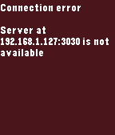

<!-- Generated by scripts/update_app_directory.py: do not edit by hand -->
[← All Pebble Developers](../developers.md)

# Roman Matiasko

*1 app · Last updated 2026-10-12 · [About these lists](../about-app-lists.md)*

Links: [Pebble App Store](https://apps.repebble.com/apps/dev/roman-matiasko_566068a80ea7f7e7a900003e) · [GitHub (romanmatiasko)](https://github.com/romanmatiasko)

<h2 class="app-name" id="app-568a4cfa496916a93f00004e"><a href="https://apps.repebble.com/568a4cfa496916a93f00004e">Exec File</a> v1.0</h2>
<a class="app-source" href="https://github.com/romanmatiasko/exec-file-pebble" title="Source code" data-search-exclude>View source</a>

App

Released 2016-01-04 Updated 2016-01-04

Runs on: Round 2, Time 2, Pebble 2 Duo, Pebble 2, Time Round, Time, Classic

An app that allows you to execute remote files from your pebble. The app needs a companion app, server, to be running on your local network and to be accessible via HTTP. The number of files that…

