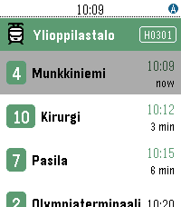

<!-- Generated by scripts/update_app_directory.py: do not edit by hand -->
[← All Pebble Developers](../developers.md)

# Roni Helppi

*1 app · Last updated 2026-10-12 · [About these lists](../about-app-lists.md)*

Links: [Pebble App Store](https://apps.repebble.com/apps/dev/roni-helppi_54ecb43fb5dab6350500009c) · [GitHub (ronijaakkola)](https://github.com/ronijaakkola)

<h2 class="app-name" id="app-579e0b101482cd0515000491"><a href="https://apps.repebble.com/579e0b101482cd0515000491">Vuoro</a> v2.2.0</h2>
<a class="app-source" href="https://github.com/ronijaakkola/trebble" title="Source code" data-search-exclude>View source</a>

App

Released 2016-07-31 Updated 2026-07-07

Runs on: Round 2, Time 2, Pebble 2 Duo, Pebble 2, Time Round, Time, Classic

Vuoro finds the nearest public transport stops in Finland using your phone&#x27;s GPS and shows the next departing lines with real-time predictions. Pin your favourite stops, see your city and zone at…

