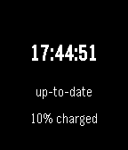

<!-- Generated by scripts/update_app_directory.py: do not edit by hand -->
[← All Pebble Developers](../developers.md)

# RooneyWorks

*1 watchface · Last updated 2026-10-12 · [About these lists](../about-app-lists.md)*

Links: [Pebble App Store](https://apps.repebble.com/apps/dev/rooneyworks_52f3d06322d1e070e2000369) · [GitHub (NanoExplorer)](https://github.com/NanoExplorer)

<h2 class="app-name" id="app-561ae9444f81efef81000022"><a href="https://apps.repebble.com/561ae9444f81efef81000022">Local Sidereal Time Watchface</a> v1.2</h2>
<a class="app-source" href="http://github.com/NanoExplorer/siderealPebble" title="Source code" data-search-exclude>View source</a>

Watchface

No licence Released 2015-10-11 Updated 2016-03-01

Runs on: Time 2, Pebble 2 Duo, Pebble 2, Time, Classic

A watchface that displays the local sidereal time! Sidereal time is used by astronomers to determine the positions of the stars in the sky at the current time. A sidereal day is four minutes…

