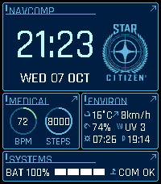

<!-- Generated by scripts/update_app_directory.py: do not edit by hand -->
[← All Pebble Developers](../developers.md)

# Rorist

*1 watchface · Last updated 2026-10-12 · [About these lists](../about-app-lists.md)*

Links: [Pebble App Store](https://apps.repebble.com/apps/dev/rorist_97c71fc3e57e598d48f2670f) · [GitHub (rorist)](https://github.com/rorist)

<h2 class="app-name" id="app-e0270f35ea0b418589fa0866"><a href="https://apps.repebble.com/e0270f35ea0b418589fa0866">mobiGlas</a> v0.3.2</h2>
<a class="app-source" href="https://github.com/rorist/sc-mobiglas" title="Source code" data-search-exclude>View source</a>

Watchface

Released 2026-09-23 Updated 2026-10-07

Runs on: Round 2, Time 2, Pebble 2 Duo

A fan-made opensource watchface inspired by Star Citizen&#x27;s holographic mobiGlas interface, a space simulation game in development ;) Time (12h/24h), live weather (temperature, conditions, wind…

