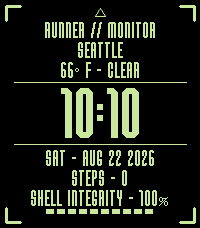

<!-- Generated by scripts/update_app_directory.py: do not edit by hand -->
[← All Pebble Developers](../developers.md)

# Rosaaen.DEV

*1 watchface · Last updated 2026-10-11 · [About these lists](../about-app-lists.md)*

Links: [Pebble App Store](https://apps.repebble.com/apps/dev/rosaaen-dev_483499bd55b325bb5eb807ec) · [GitHub (InsanityOnABun)](https://github.com/InsanityOnABun)

<h2 class="app-name" id="app-bba7d202634a4bb2bab52b85"><a href="https://apps.repebble.com/bba7d202634a4bb2bab52b85">RUNNER // MONITOR</a> v1.0.5</h2>
<a class="app-source" href="https://github.com/InsanityOnABun/RunnerMonitor" title="Source code" data-search-exclude>View source</a>

Watchface

No licence Released 2026-07-26 Updated 2026-08-23

Runs on: Round 2, Time 2

Based on the UI and design style of the 2026 Bungie game, Marathon. Follows system 12h/24h option, and indicates bluetooth disconnection, quiet mode, and charging status. Color is as close to…

