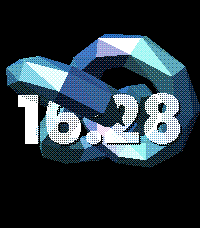
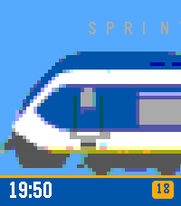

<!-- Generated by scripts/update_app_directory.py: do not edit by hand -->
[← All Pebble Developers](../developers.md)

# Ross Gardiner

*2 watchfaces · Last updated 2026-10-12 · [About these lists](../about-app-lists.md)*

Links: [Pebble App Store](https://apps.repebble.com/apps/dev/ross-gardiner_c9373569fe7360f24a6b1a70) · [GitHub (rossng)](https://github.com/rossng) · [Website (rossng.eu)](http://www.rossng.eu/pebble-watchfaces/)

<button type="button" data-filter="all" aria-pressed="true">All 2</button><button type="button" data-filter="watchface" aria-pressed="false">Watchfaces 2</button><button type="button" data-filter="watchapp" aria-pressed="false" disabled>Apps 0</button>

<label class="dev-sort">Sort by <select><option value="updated">Recently updated</option><option value="released">Newest release</option><option value="title">A–Z</option></select></label>

<h2 class="app-name" id="app-da990f30581f4c9aaaa6fb6d"><a href="https://apps.repebble.com/da990f30581f4c9aaaa6fb6d">Graphics Gems</a> v1.0.9</h2>
<a class="app-source" href="https://github.com/rossng/pebble-watchfaces/tree/main/watchfaces/graphics-gems" title="Source code" data-search-exclude>View source</a>

Watchface

Released 2026-06-27 Updated 2026-06-28

Runs on: Round 2, Time 2

A native Pebble watchface that renders the classics of computer-graphics research — the Utah teapot, the Stanford bunny, an icosphere and a torus knot — with a from-scratch software rasterizer…

<h2 class="app-name" id="app-828038d2a34d45eb8b3daa37"><a href="https://apps.repebble.com/828038d2a34d45eb8b3daa37">Passing Trains</a> v1.0.0</h2>
<a class="app-source" href="https://github.com/rossng/pebble-watchfaces" title="Source code" data-search-exclude>View source</a>

Watchface

Released 2026-06-18 Updated 2026-06-18

Runs on: Round 2, Time 2

A native Pebble C watchface that slowly pans along a random Dutch (NS) train, minute by minute, scaled to fill the screen. A subtle type label floats above each train; the time sits in a bottom…

