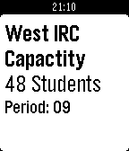

<!-- Generated by scripts/update_app_directory.py: do not edit by hand -->
[← All Pebble Developers](../developers.md)

# Rossmallow

*2 watchfaces and 1 app · Last updated 2026-10-12 · [About these lists](../about-app-lists.md)*

Links: [Pebble App Store](https://apps.repebble.com/apps/dev/rossmallow_55515dcbe979af62610000a1) · [GitHub (Rossmallow)](https://github.com/Rossmallow)

<button type="button" data-filter="all" aria-pressed="true">All 3</button><button type="button" data-filter="watchface" aria-pressed="false">Watchfaces 2</button><button type="button" data-filter="watchapp" aria-pressed="false">Apps 1</button>

<label class="dev-sort">Sort by <select><option value="updated">Recently updated</option><option value="released">Newest release</option><option value="title">A–Z</option></select></label>

<h2 class="app-name" id="app-582a6fa48c7fff9edf0001fa"><a href="https://apps.repebble.com/582a6fa48c7fff9edf0001fa">Mars Time</a> v1.0</h2>
<a class="app-source" href="https://github.com/Rossmallow/Mars-Time-Watchface" title="Source code" data-search-exclude>View source</a>

Watchface

No licence Released 2016-11-15 Updated 2016-11-15

Runs on: Time 2, Pebble 2 Duo, Pebble 2, Time, Classic

Each second on Mars is about half of a second on Earth. This watchface simulates time passing on Mars by incrementing time by about 32 seconds per minute starting from the time the watchface is…

<h2 class="app-name" id="app-56e4df54da71e3d55a00002e"><a href="https://apps.repebble.com/56e4df54da71e3d55a00002e">D219 IRC Capacity</a> v1.0</h2>
<a class="app-source" href="https://github.com/Rossmallow/D219-IRC-Capacity-WatchApp/blob/master/src/app.js" title="Source code" data-search-exclude>View source</a>

App

No licence Released 2016-03-13 Updated 2016-03-13

Runs on: Time 2, Pebble 2 Duo, Pebble 2, Time, Classic

A WatchApp that displays the Information Resource Center capacity data for District 219 high schools, North and West. On the title screen press the up button to get Niles North&#x27;s information, or…

<h2 class="app-name" id="app-55fc96d20a54828cc7000014"><a href="https://apps.repebble.com/55fc96d20a54828cc7000014">NW Schedule</a> v1.0</h2>
<a class="app-source" href="https://github.com/Rossmallow/NW-Schedule-Watchface/blob/master/src/main.c" title="Source code" data-search-exclude>View source</a>

Watchface

No licence Released 2015-09-18 Updated 2015-09-20

Runs on: Time 2, Pebble 2 Duo, Pebble 2, Time, Classic

A watch face that displays the current period and when it ends on the regular bell schedule at Niles West High School. User Guide: &quot;Period&quot;, along with stating numbers that correspond with the…

