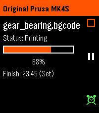

<!-- Generated by scripts/update_app_directory.py: do not edit by hand -->
[← All Pebble Developers](../developers.md)

# RP1-MVac

*1 app · Last updated 2026-10-12 · [About these lists](../about-app-lists.md)*

Links: [Pebble App Store](https://apps.repebble.com/apps/dev/rp1-mvac_6ac14dc643575a0009d9385a) · [GitHub (RP1-MVac)](https://github.com/RP1-MVac)

<h2 class="app-name" id="app-6ac1601e855b950009abfe3a"><a href="https://apps.repebble.com/6ac1601e855b950009abfe3a">Prusa Connect (unofficial)</a> v1.1.0</h2>
<a class="app-source" href="https://github.com/RP1-MVac/Prusa-Connect-Client-for-Pebble" title="Source code" data-search-exclude>View source</a>

App · <a href="https://forum.rebble.io/t/1404" title="Discuss this app on the Rebble forum" data-search-exclude>Forum thread</a>

MIT Released 2026-10-03 Updated 2026-10-06

Runs on: Round 2, Time 2

If you own a Prusa printer and want to view it&#x27;s print progress, stop it or set an alarm for when it&#x27;s done on your Pebble this app is for you. It uses the reverse engineered Prusa Connect API and…

