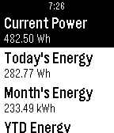

<!-- Generated by scripts/update_app_directory.py: do not edit by hand -->
[← All Pebble Developers](../developers.md)

# rS

*2 apps · Last updated 2026-10-12 · [About these lists](../about-app-lists.md)*

Links: [Pebble App Store](https://apps.repebble.com/apps/dev/rs_52f049ef1ac794fac8001087) · [GitHub (ace7196)](https://github.com/ace7196)

<button type="button" data-filter="all" aria-pressed="true">All 2</button><button type="button" data-filter="watchface" aria-pressed="false" disabled>Watchfaces 0</button><button type="button" data-filter="watchapp" aria-pressed="false">Apps 2</button>

<label class="dev-sort">Sort by <select><option value="updated">Recently updated</option><option value="released">Newest release</option><option value="title">A–Z</option></select></label>

<h2 class="app-name" id="app-5587333c49c1d1c16d000037"><a href="https://apps.repebble.com/5587333c49c1d1c16d000037">ColorTest</a> v1.1</h2>
<a class="app-source" href="https://github.com/ace7196/ColorTest" title="Source code" data-search-exclude>View source</a>

App

No licence Released 2015-06-21 Updated 2015-06-22

Runs on: Time 2, Pebble 2 Duo, Pebble 2, Time, Classic

Just a basic app to show you what black and white text look like with different background colors on the actual screen.

<h2 class="app-name" id="app-557c39d85f5eb87f5800001f"><a href="https://apps.repebble.com/557c39d85f5eb87f5800001f">SolarInfo</a> v1.1</h2>
<a class="app-source" href="https://github.com/ace7196/ConfigSolarMonitor" title="Source code" data-search-exclude>View source</a>

App

No licence Released 2015-06-13 Updated 2015-06-21

Runs on: Time 2, Pebble 2 Duo, Pebble 2, Time, Classic

This is a Watchapp that grabs info from the SolarEdge Technologies Inc. © API for your site and will relay information such as current power generation, as well as historical energy production. To…

