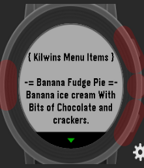
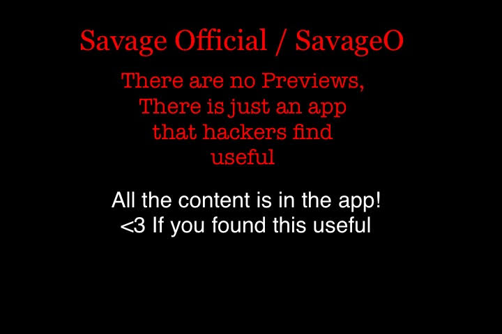
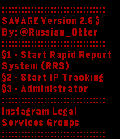

<!-- Generated by scripts/update_app_directory.py: do not edit by hand -->
[← All Pebble Developers](../developers.md)

# Russian Otter

*6 apps · Last updated 2026-10-12 · [About these lists](../about-app-lists.md)*

Links: [Rebble App Store](https://apps.rebble.io/en_US/developer/549c0abd0544722d37000293/1) · [Pebble App Store](https://apps.repebble.com/apps/dev/russian-otter_549c0abd0544722d37000293)

<button type="button" data-filter="all" aria-pressed="true">All 6</button><button type="button" data-filter="watchface" aria-pressed="false" disabled>Watchfaces 0</button><button type="button" data-filter="watchapp" aria-pressed="false">Apps 6</button>

<label class="dev-sort">Sort by <select><option value="updated">Recently updated</option><option value="released">Newest release</option><option value="title">A–Z</option></select></label>

<h2 class="app-name" id="app-58d412536ca387b8da0001b2"><a href="https://apps.rebble.io/en_US/application/58d412536ca387b8da0001b2">Kilwins Store</a> v1.0</h2>
<a class="app-source" href="https://www.kilwins.com/" title="Source code" data-search-exclude>View source</a>

App

Released 2017-03-23 Updated 2017-03-23 Rebble App Store

Runs on: Time 2, Time

This app contains a full list of all the ice creams found at Kilwins Ice Cream and Candy Stores! Updates will come out soon for more information on all the items! Kilwins: sweet in every sense…

<h2 class="app-name" id="app-574102491b2ed80e6300002d"><a href="https://apps.repebble.com/574102491b2ed80e6300002d">SQL Episode 2</a> v1.0</h2>
<a class="app-source" href="https://instagram.com/russian_otter/" title="Source code" data-search-exclude>View source</a>

App

Released 2016-05-22 Updated 2016-10-28

Runs on: Round 2, Time 2, Pebble 2 Duo, Pebble 2, Time Round, Time, Classic

This is an app that is full of dork codes, vpns, and other information that new hackers find useful! We at SAVAGEO hope you enjoy this app! It is episode 2 in it&#x27;s series of hacking apps /…

<h2 class="app-name" id="app-5740f39cb8bc1b0b89000019"><a href="https://apps.repebble.com/5740f39cb8bc1b0b89000019">SQL Episode 1</a> v1.0</h2>
<a class="app-source" href="https://instagram.com/russian_otter/" title="Source code" data-search-exclude>View source</a>

App

Released 2016-05-21 Updated 2016-05-22

Runs on: Round 2, Time 2, Pebble 2 Duo, Pebble 2, Time Round, Time, Classic

We here at SavageO would like to present to you: SQL hacking Episode 1 This is a very basic and important understanding of SQL Injection coding that covers small important things! Its like an…

<h2 class="app-name" id="app-56b16e2a10121e5d36000001"><a href="https://apps.repebble.com/56b16e2a10121e5d36000001">SAVAGE For Basalt -Preview- v2.6</a> v2.6</h2>
<a class="app-source" href="https://www.instagram.com/russian_otter/" title="Source code" data-search-exclude>View source</a>

App

Released 2016-02-03 Updated 2016-02-03

Runs on: Time 2, Pebble 2 Duo, Pebble 2, Time, Classic

This is a preview for the program I made call Savage2v4.2.6. This client simplifys tasks and has features that allow it to be very effective with computers. Its also good for legal reporting of…

<h2 class="app-name" id="app-55fa03db37ac97db7a000019"><a href="https://apps.repebble.com/55fa03db37ac97db7a000019">AGR DEPLOYMENT V2</a> v2.0</h2>
<a class="app-source" href="https://instagram.com/russian_otter/" title="Source code" data-search-exclude>View source</a>

App

Released 2015-09-17 Updated 2015-09-17

Runs on: Time 2, Pebble 2 Duo, Pebble 2, Time, Classic

AGR summon from call of duty black ops! select from 3 deployments: Press &quot;up&quot; to call in Black Bird Press &quot;down&quot; to call in RC XD Press &quot;Middle&quot; to summon AGR Works for all versions of pebble…

<h2 class="app-name" id="app-55f9eace416b6885e6000010"><a href="https://apps.repebble.com/55f9eace416b6885e6000010">Deploy AGR</a> v1.0</h2>
<a class="app-source" href="https://instagram.com/russian_otter/" title="Source code" data-search-exclude>View source</a>

App

Released 2015-09-16 Updated 2015-09-16

Runs on: Time 2, Pebble 2 Duo, Pebble 2, Time, Classic

Call in your own agr from your pebble smart watch! This app gives the cool effect that you summoned an agr :D. COD Call of duty black ops

