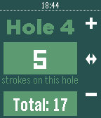

<!-- Generated by scripts/update_app_directory.py: do not edit by hand -->
[← All Pebble Developers](../developers.md)

# Ryan Anderson

*1 app · Last updated 2026-10-12 · [About these lists](../about-app-lists.md)*

Links: [Pebble App Store](https://apps.repebble.com/apps/dev/ryan-anderson_52cb46dee2dd026853000093) · [GitHub (anderson-michael-ryan)](https://github.com/anderson-michael-ryan) · [Website (twitter.com)](https://twitter.com/anderson_m_ryan)

<h2 class="app-name" id="app-536f821e5c6fab9d0c00015f"><a href="https://apps.repebble.com/536f821e5c6fab9d0c00015f">Stroke Keeper</a> v3.3</h2>
<a class="app-source" href="https://www.github.com/anderson-michael-ryan/PebbleStrokeKeeper/tree/master/src" title="Source code" data-search-exclude>View source</a>

App

Released 2014-05-11 Updated 2016-08-19

Runs on: Round 2, Time 2, Pebble 2 Duo, Pebble 2, Time Round, Time, Classic

Stroke Keeper is the perfect watch app that you need to keep track of your golf score whenever your out on the course. I am proud to say that after a couple thousand of downloads we are still…

