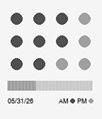

<!-- Generated by scripts/update_app_directory.py: do not edit by hand -->
[← All Pebble Developers](../developers.md)

# Ryan Cady

*1 watchface · Last updated 2026-10-12 · [About these lists](../about-app-lists.md)*

Links: [Pebble App Store](https://apps.repebble.com/apps/dev/ryan-cady_6b36b1b6a4cad298e6639bbc) · [GitHub (ryan-cady)](https://github.com/ryan-cady) · [Website (buymeacoffee.com)](https://buymeacoffee.com/ryancady)

<h2 class="app-name" id="app-138a60b65bfb41948e2de233"><a href="https://apps.repebble.com/138a60b65bfb41948e2de233">PNOOKA</a> v1.2.4</h2>
<a class="app-source" href="https://github.com/ryan-cady/pnooka" title="Source code" data-search-exclude>View source</a>

Watchface

Released 2026-05-31 Updated 2026-06-03

Runs on: Time 2, Pebble 2 Duo, Pebble 2, Time, Classic

A minimal dot-matrix watchface inspired by Nooka&#x27;s abstract time aesthetic. Hours are shown as a 4×3 grid of dots — they fill column by column as the day progresses. A 60-segment bar below counts…

