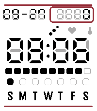

<!-- Generated by scripts/update_app_directory.py: do not edit by hand -->
[← All Pebble Developers](../developers.md)

# Ryan Howell

*1 watchface · Last updated 2026-10-12 · [About these lists](../about-app-lists.md)*

Links: [Pebble App Store](https://apps.repebble.com/apps/dev/ryan-howell_d2df98349c16bc7e5cc06453) · [GitHub (TheRyanHowell)](https://github.com/TheRyanHowell)

<h2 class="app-name" id="app-f319e01edc884349b8da93a4"><a href="https://apps.repebble.com/f319e01edc884349b8da93a4">CrystalTick</a> v1.0.0</h2>
<a class="app-source" href="https://github.com/TheRyanHowell/crystaltick" title="Source code" data-search-exclude>View source</a>

Watchface · <a href="https://forum.rebble.io/t/1385" title="Discuss this app on the Rebble forum" data-search-exclude>Forum thread</a>

AGPL-3.0 Released 2026-09-27 Updated 2026-09-27

Runs on: Time 2

A retro Casio/LCD-style watchface for the Pebble Time 2, inspired by Quartz by Dalpek but built from scratch. Features: • Retro 7-segment LCD look with a dim &quot;ghost segment&quot; background simulating…

