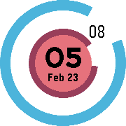

<!-- Generated by scripts/update_app_directory.py: do not edit by hand -->
[← All Pebble Developers](../developers.md)

# Ryan Perry-Nguyen

*1 watchface · Last updated 2026-10-12 · [About these lists](../about-app-lists.md)*

Links: [Pebble App Store](https://apps.repebble.com/apps/dev/ryan-perry-nguyen_5567c51b95889755d8000092) · [GitHub (rperryng)](https://github.com/rperryng)

<h2 class="app-name" id="app-56cbab646e84e5d684000054"><a href="https://apps.repebble.com/56cbab646e84e5d684000054">Chrono Ring</a> v1.8</h2>
<a class="app-source" href="https://github.com/rperryng/pebble-chrono-ring" title="Source code" data-search-exclude>View source</a>

Watchface

Released 2016-02-23 Updated 2016-03-31

Runs on: Round 2, Time Round

🌺 Minimalist and practical round design. Made with love. Something missing? Reach out and let me know.

